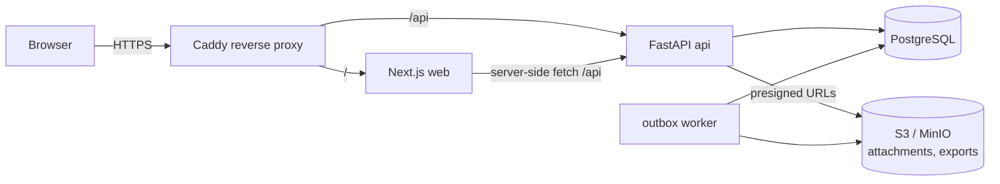
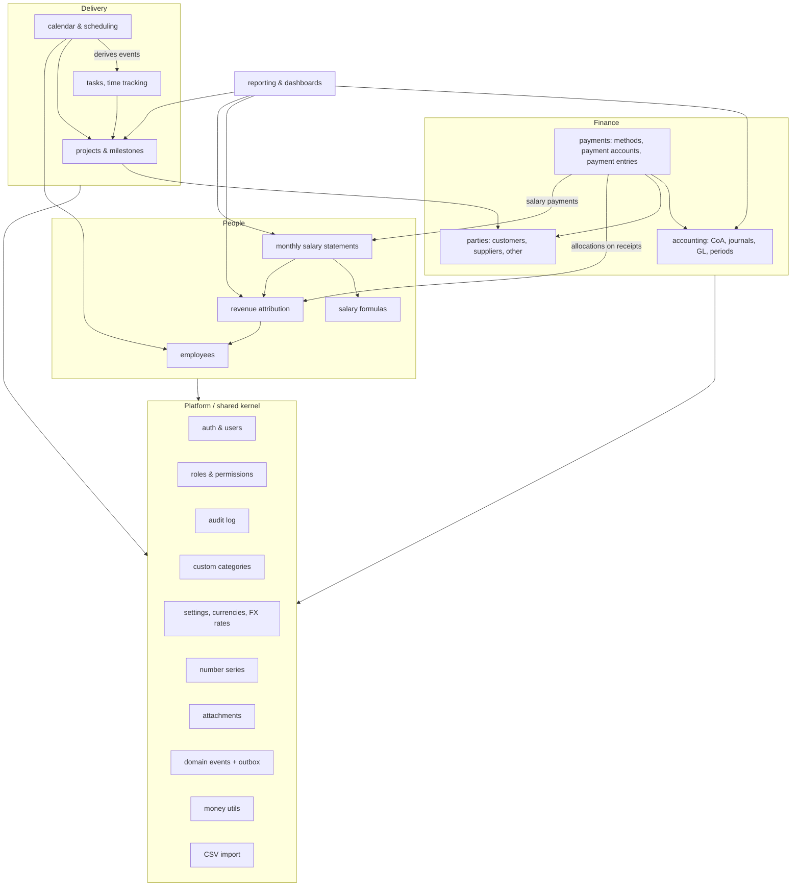
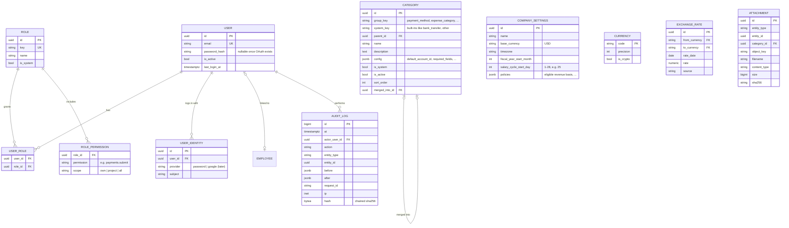
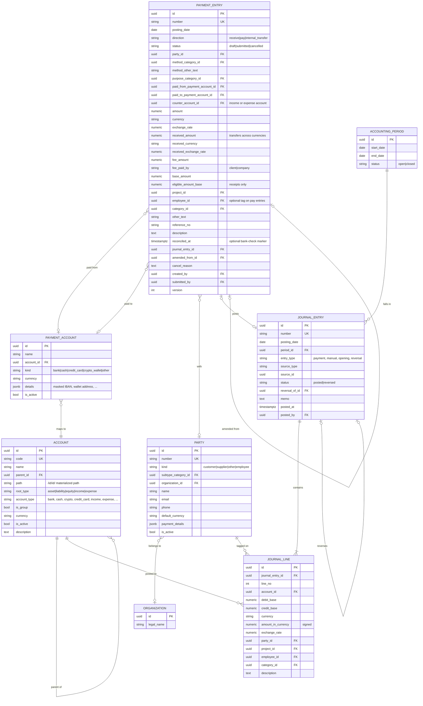
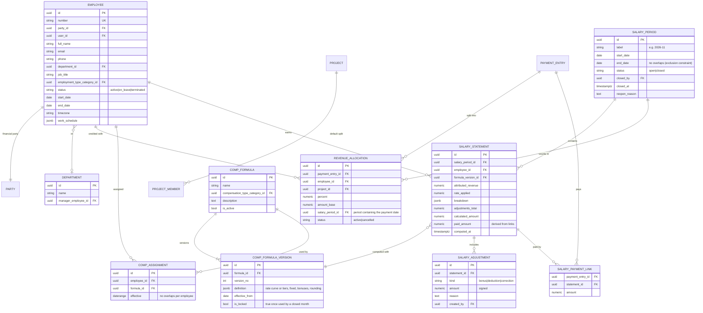
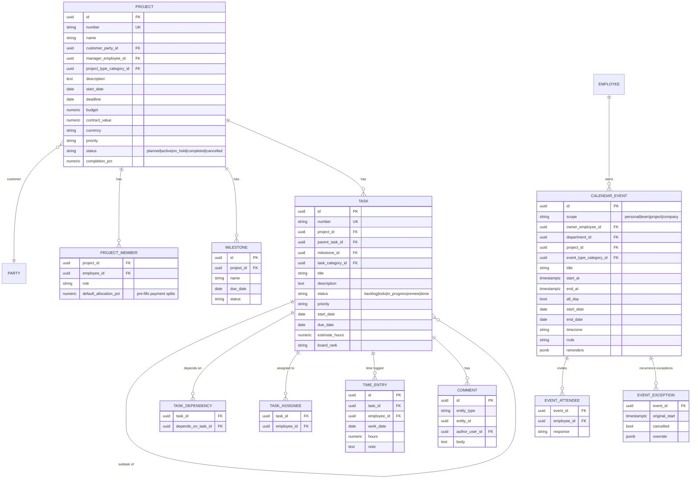
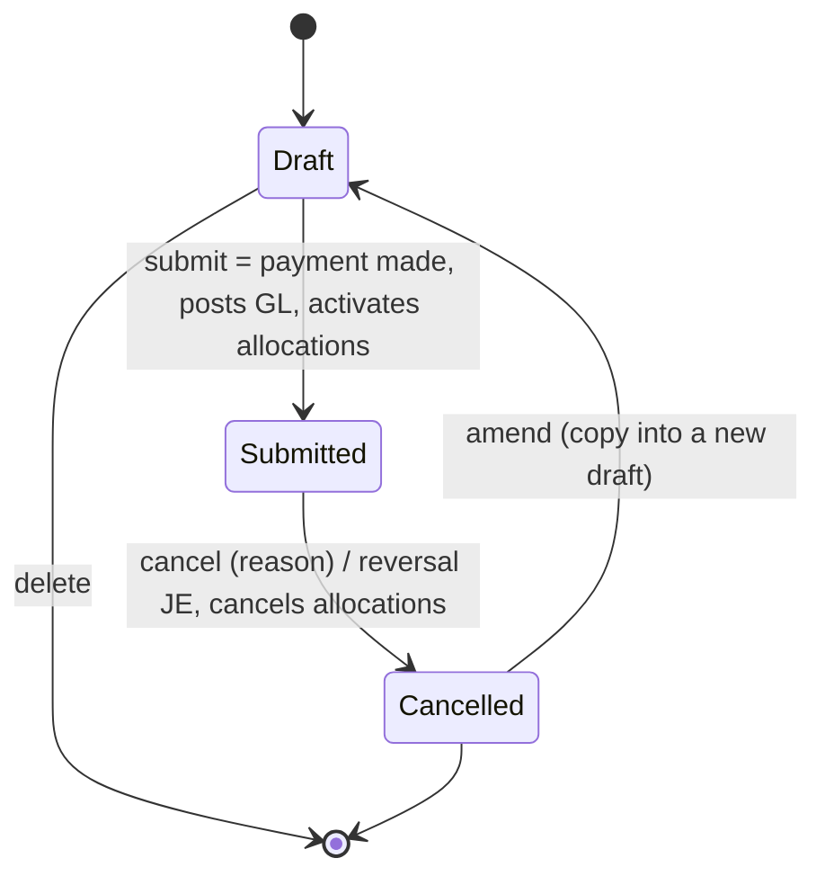
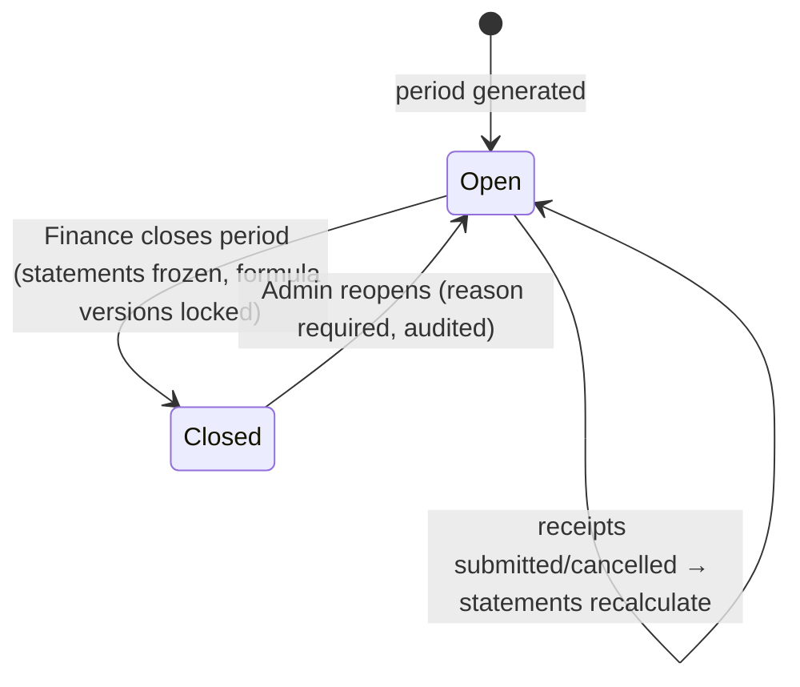
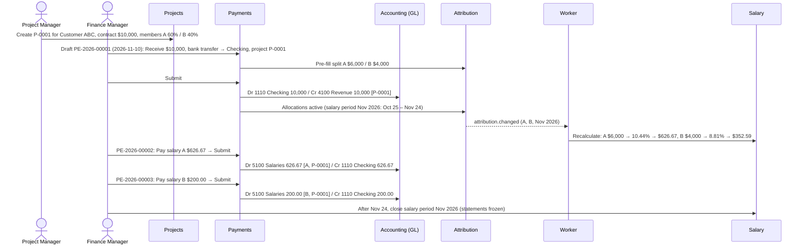

# ERP for a Software Services Company — Architecture & Design (v0.6)

Status: **All six phases built. All business rules agreed, including the salary follow-ups (Section 2.3).**
Date: 2026-10-27 · v0.6 2026-10-28 (Phase 3 implementation notes)

Contents

1. Requirements analysis
2. Decision log
3. System architecture
4. Data model conventions
5. Entity-relationship diagrams
6. Accounting data model
7. Payment Entry workflow and posting rules
8. Employee revenue attribution
9. Salary formula engine
10. Monthly salary (payroll)
11. Projects, tasks, calendar and timeline integration
12. Custom Categories and "Other"
13. REST API structure
14. Frontend screen structure
15. Security and permissions model
16. End-to-end reference scenario (with numbers)
17. Testing strategy
18. Phased implementation plan
19. Technical risks and recommendations

---

## 1. Requirements analysis

### 1.1 What the system is

A single-company, web-based ERP for a technology-services business. The company records money **when it actually moves** (cash basis). There is no invoicing. The spine is:

```
Customer → Project → Payment Entry (receive) → General Ledger
                          │
                          └→ Revenue Attribution (employees) → Salary Formula → Monthly Salary Statement
                                                                                       │
                                     Payment Entry (pay salary) → General Ledger ◄─────┘
```

Two separate "books" exist side by side and must never be confused:

| Book | Purpose | Source of truth | Mutability |
|---|---|---|---|
| **Financial (GL)** | Accounting balances, P&L, Balance Sheet | Posted `journal_lines` | Immutable. A cancelled payment gets an automatic reversal entry |
| **Management (attribution & salary)** | Who generated which revenue, and what they earn from it | `revenue_allocations`, `salary_statements` | Recomputed live while a month is open, frozen when the month is closed |

The bridges between the two are explicit:

- A **submitted customer receipt** (GL) supplies the revenue that is split between employees.
- A **salary Payment Entry** (GL: Dr Salary Expense / Cr Bank) reduces the employee's salary balance.

### 1.2 Concepts that must stay distinct

| Concept | Where it lives | Example (Section 16) |
|---|---|---|
| Customer payment (cash received) | Payment Entry + GL debit to bank | $10,000 into Checking |
| Company revenue | GL credit to an Income account | $10,000 Software Development Revenue |
| Project revenue | GL income lines tagged with `project_id` | $10,000 on P-0001 |
| Contract value | Project field, no accounting effect | $10,000 |
| Employee-attributed revenue | `revenue_allocations` (no GL effect) | A $6,000, B $4,000 |
| Calculated salary (earned) | `salary_statements` (no GL effect) | A $626.67, B $352.59 |
| Salary expense (P&L) | GL, posted when salary is **paid** | $826.67 paid in November |
| Salary owed to employee | Calculated − paid, from statements | B $152.59 |

### 1.3 Scope

**In scope (v1):** double-entry GL on a cash basis, Chart of Accounts, Payment Entries (receive / pay / internal transfer) with multi-currency and crypto, parties, employees, revenue attribution, configurable salary formulas, monthly salary statements, projects/tasks/Kanban/Gantt, calendars, dashboards, reports with CSV/XLSX/PDF export, RBAC, audit logs, custom categories, data import.

**Out of scope (v1):** invoicing (sales invoices, supplier bills, receivables, payables), approval workflows, salary accruals/payables, salary advances as a separate concept, inventory, tax, statutory payroll deductions, bank feeds, FX revaluation, multi-company, Google OAuth (planned as a later add-on).

### 1.4 Non-functional requirements

- **Correctness first:** every posting is balanced, atomic, idempotent and traceable to its Payment Entry.
- **Decimal-only money:** `NUMERIC` in Postgres, `Decimal` in Python, strings in JSON, `decimal.js` in the browser. Floats are banned by a lint rule.
- **Auditability:** append-only audit log for every submit, cancel, month close/reopen, and every edit to sensitive data.
- **Performance target:** GL reports over 5 years × ~50k lines/year in < 2 s. List screens < 300 ms p95.
- **Backups:** daily full backup + WAL archiving (point-in-time recovery, RPO ≤ 15 min).
- **Scale assumption:** < 200 users, < 1M journal lines in the first years. One Postgres and a modular monolith are plenty.

---

## 2. Decision log

### 2.1 Answers received (2026-10-27)

| # | Topic | Decision | Design consequence |
|---|---|---|---|
| Q1 | Invoicing | **None** | Cash basis: a customer payment credits an Income account directly. No AR/AP accounts, no invoice documents. A party's "balance" becomes "total received / total paid" |
| Q2 | Fees | Sometimes the client pays the fee, sometimes we do | Payment Entry gets `fee_amount` + `fee_paid_by` (`client` / `company`). Only company-paid fees are posted (to Bank & Payment Fees) |
| Q3 | Refunds / mistakes | **Cancel the original payment** (no negative attribution rows) | Cancelling a payment cancels its allocations. The GL gets an automatic reversal dated the same day, so the payment disappears from all reports. A partial refund = cancel + re-enter the corrected payment |
| Q4 | Salary formula | Decide in detail later. Current rule: no salary below $3k. Rate rises gradually from 8% at $3k to 30% at $30k | Formula engine supports a **linear rate curve** (plus tiers for later). The current rule ships as the provisional default formula (Section 9.3) |
| Q5, Q7 | Payment logic | Simple: creating and submitting a Payment Entry *is* the payment | Workflow is just **Draft → Submitted** (plus Cancelled). No approval, no salary accrual/payable, no advance logic. Salary paid = salary expense, posted at payment time |
| Q6 | Currency | **USD** base | USD base. Other fiat and crypto amounts convert at the transaction-date rate |
| Q8 | Approvals | **None** | Creator can submit their own entries. No thresholds |
| Q9 | Salary basis | Salary comes from each employee's income. Every customer payment is assigned to one or more employees, who share it | Customer receipts **require a 100% employee allocation before submit**. Salary = formula(employee's monthly attributed revenue) |
| Q10 | Employee view | Read-only | Employees see their own revenue, formula, calculated and paid salary, read-only |
| Q11 | Data migration | Yes | Opening Balance entry wizard + CSV import for parties, employees, projects (Phase 2) |
| Q12 | Login | Email/password now, Google OAuth later | Argon2id email/password. Auth module designed with a pluggable provider so Google OIDC can be added without schema changes |
| Q13 | Hosting | Single VM with Docker Compose | Docker Compose behind Caddy, S3-compatible storage, managed backups |
| Q14 | Revenue/salary period | Not the calendar month. Configurable cycle start day, e.g. the **25th** (25th → 24th) | `salary_cycle_start_day` company setting. Salary periods are stored rows with explicit start/end dates. Attribution and salary use these periods. Accounting stays on calendar months (Section 10.1) |

### 2.2 Interpretations I made (tell me if any are wrong)

1. **Salary expense is recorded when salary is paid**, not when it is earned. This follows from "submit = paid, no complicated logic". The P&L therefore shows salary in the month it was paid. The dashboard shows "salary owed, not yet paid" separately so month-end profit isn't misleading. Accruals can be switched on later without migrating data.
2. **Each employee has a running salary balance** = Σ calculated salary − Σ salary paid. A salary payment pays off the oldest unpaid month first (or a month you pick). Overpaying simply leaves a credit that the next month uses up. This replaces "advances" and "partial payroll" logic.
3. **Closing a salary period** (Finance) freezes that period's salary statements. If a payment from a closed period is cancelled later, an Admin must **reopen** that period (audited, with a reason). Its statements then recalculate and the difference flows into the employee's balance.
4. **Anyone with a salary formula gets monthly statements**, including contractors and freelancers. People paid without a formula are Suppliers.

### 2.3 Salary follow-ups (answered 2026-10-28)

| # | Question | Answer |
|---|---|---|
| F1 | Above $30k, does the rate stay at 30%? | **Yes**, it stays at 30% |
| F2 | The curve has a jump at $3k ($2,999 → $0, $3,000 → $240). Intended? | **Yes** |
| F3 | Is the rate applied to the whole monthly revenue? (At $6k: rate 10.44% × $6,000 = $626.67) | **Yes**, the whole amount |
| F4 | When **we** pay a processor fee, does the employee's revenue count before or after the fee? | **After** (net): a $10,000 receipt with a $30 company-paid fee counts as $9,970. Still switchable in company settings |

---

## 3. System architecture

### 3.1 Technology stack

| Layer | Choice | Additions |
|---|---|---|
| Frontend | Next.js 15 (App Router), React, TypeScript, Tailwind, shadcn/ui, TanStack Table, React Hook Form, Zod | TanStack Query (server state), `openapi-typescript` (types generated from FastAPI), `decimal.js`, FullCalendar (MIT core), `frappe-gantt` (MIT) or custom SVG Gantt, `dnd-kit` (Kanban), Recharts |
| Backend | Python 3.12+, FastAPI, SQLAlchemy 2.x (async, asyncpg), Alembic, Pydantic v2 | Outbox worker (`python -m app.worker`, Postgres-only), `python-dateutil` (recurrence), `openpyxl` / `WeasyPrint` (exports), `structlog`, an AST test that enforces module boundaries. Redis is added only when a feature needs it (e.g. scheduled reminders) |
| Database | PostgreSQL 16 | Materialized id paths for the account tree (`path LIKE prefix%`), `btree_gist` (no-overlap date ranges) |
| Infra | Docker Compose: `postgres`, `migrate`, `api`, `worker`, `web`, `caddy` | Attachments on a local volume in Phase 1; an S3-compatible backend (S3, R2, MinIO) plugs in behind the same storage interface |

### 3.2 Deployment view



Web and API share one origin (`/` and `/api`), so authentication uses httpOnly session cookies with no CORS setup. A CSRF token protects unsafe methods.

### 3.3 Module architecture (modular monolith)



Rules that keep the monolith modular:

1. Each module is a package `app/modules/<name>/` with `models.py`, `schemas.py`, `service.py`, `repository.py`, `router.py`, `permissions.py`, and a **public facade `api.py`**.
2. Modules import only other modules' `api.py`, never their models. A test (`tests/test_architecture.py`) enforces this in CI.
3. Writes that must be consistent (payment submit → GL → allocations) happen through facade calls **in one database transaction**. Reactions that can lag (salary recalculation, notifications, report caches) go through an **outbox table** processed by the worker.
4. Only `accounting` writes journal rows, through one function: `accounting.api.post_journal(...)`.

### 3.4 Repository layout

```
apps/api/
  app/
    main.py
    core/            config, db, security, money, errors, pagination, idempotency, outbox
    modules/
      auth/  rbac/  audit/  categories/  settings/  attachments/  imports/
      parties/  accounting/  payments/
      employees/  attribution/  compensation/  salary/
      projects/  tasks/  calendar/  reporting/
  migrations/        Alembic
  tests/             unit/, integration/ (real Postgres via testcontainers), e2e/
  seeds/             chart of accounts, categories, demo data
apps/web/
  app/(auth)/  app/(app)/…   see Section 14
  components/ui (shadcn)  components/erp (DataTable, MoneyInput, CategorySelect, AllocationEditor, …)
  lib/api (generated client)  lib/money  lib/permissions
infra/
  docker-compose.yml  docker-compose.prod.yml  Caddyfile  backup/
docs/
```

### 3.5 Cross-cutting services

| Service | Responsibility |
|---|---|
| `money` | `Money(amount, currency)`, quantize to currency precision, half-up rounding, largest-remainder splitting so shares always add up exactly |
| `number_series` | Human document numbers per type and year (`PE-2026-00042`) |
| `idempotency` | `Idempotency-Key` header on create/submit/cancel. A double-click or retry never creates two payments |
| `audit` | `audit.record(actor, action, entity, before, after)`, append-only |
| `outbox` | `outbox_events` written in the same transaction, processed by the worker with `FOR UPDATE SKIP LOCKED` |
| `fx` | Exchange-rate table (manual + optional daily fetch). Rate lookup by date, with override on each document |

---

## 4. Data model conventions

- Primary keys: **UUIDv7**. Documents also carry a human `number`.
- Money: `NUMERIC(20,4)` for fiat, `NUMERIC(38,18)` for crypto quantities, `NUMERIC(20,10)` for exchange rates. Every amount has an explicit currency.
- USD (base) equivalents are stored at submit time (`*_base` columns) and never recomputed.
- `timestamptz` in UTC. Business dates (`posting_date`) are `date` in the company time zone.
- Master data is deactivated (`is_active`), never deleted once referenced. Only drafts can be hard-deleted.
- Optimistic locking: `version` column on editable rows, exposed as `ETag`.
- Status transitions are guarded in SQL (`UPDATE … WHERE status = 'draft'`) as well as in services.
- Every document has `created_by/at`, `updated_by/at`.
- Categories are referenced by `category_id` plus an optional `other_text` for one-off "Other" values (Section 12).

---

## 5. Entity-relationship diagrams

### 5.1 Platform



### 5.2 Accounting, parties and payments



### 5.3 People: employees, attribution, formulas, salary



### 5.4 Delivery: projects, tasks, calendar



---

## 6. Accounting data model

### 6.1 Default Chart of Accounts (seed template, fully editable)

```
1000 Assets (group)
  1100 Bank Accounts (group)     1110 Company Checking · 1120 Company Savings
  1200 Cash (group)              1210 Petty Cash
  1300 Crypto Wallets (group)    1310 Bitcoin Wallet · 1320 USDT Wallet
  1900 Other Assets (group)
2000 Liabilities (group)
  2300 Credit Cards (group)      2310 Corporate Credit Card
  2900 Other Liabilities (group)
3000 Equity (group)
  3100 Owner Capital · 3200 Owner Drawings · 3300 Retained Earnings
  3400 Opening Balance Equity · 3900 Other Equity
4000 Income (group)
  4100 Software Development Revenue · 4200 AI Development Revenue
  4300 Consulting Revenue · 4400 Maintenance Revenue · 4500 Subscription Revenue
  4900 Other Income · 4950 Realized FX / Crypto Gain-Loss
5000 Expenses (group)
  5100 Employee Salaries · 5200 Cloud Infrastructure · 5300 Software Subscriptions
  5400 Marketing · 5500 Office Expenses · 5600 Bank & Payment Fees
  5900 Other Expenses (group)
```

There are no receivable or payable accounts, because there is no invoicing (Q1). "Other" is always a sub-account under one of the five root types, never a sixth type.

### 6.2 Account rules

- Only **leaf** accounts receive postings. An account's `root_type` always matches its parent's.
- Accounts with postings can be deactivated but not deleted. Inactive accounts reject new postings and still appear in reports.
- **Balances are never stored.** Balance = `SUM(debit_base − credit_base)` over posted lines for the account and its children (`path LIKE account.path || '%'`). Closed periods can be cached for speed, but the cache is always rebuilt from the GL.

### 6.3 Journal invariants (enforced by the database, not only by code)

| Invariant | Mechanism |
|---|---|
| Each entry balances: Σdebit = Σcredit (USD) | Deferred constraint trigger, checked at COMMIT |
| Each line is a debit or a credit, never both or negative | `CHECK` constraint |
| Posted lines are immutable | Trigger blocks `UPDATE`/`DELETE`. The app's DB role has no `DELETE` on journal tables |
| No posting into a closed accounting period | Insert trigger |
| A payment can post at most once, and be reversed at most once | `UNIQUE (source_type, source_id, entry_type)` |

### 6.4 Posting engine

```python
# accounting/api.py (sketch)
async def post_journal(session, *, posting_date, entry_type, source_type, source_id,
                       lines: list[JournalLineIn], memo: str, actor) -> JournalEntry: ...
async def reverse_journal(session, *, journal_entry_id, reason, actor) -> JournalEntry: ...
```

- Payments build their lines from posting rules (Section 7.3) and call `post_journal` **in the same transaction** as the status change. The payment and its GL entry commit together or not at all.
- A reversal mirrors the original lines (debits ↔ credits) and is dated **the same posting date**, so the cancelled payment nets to zero in every report for that month (Q3). The GL screens hide cancelled pairs by default, with a "show cancelled" toggle.
- Conversion rounding residue of ≤ $0.01 per line posts to a rounding account. Anything larger is a validation error.

### 6.5 Periods

Accounting periods are monthly and **open** by default. An Admin can **close** a period after checking it, which blocks new postings and cancellations dated in it. Closing is optional. Reopening is audited. A year-end closing entry (Income/Expense → Retained Earnings) is optional, because reports compute current-year earnings on the fly.

### 6.6 Multi-currency and crypto

- Base currency: **USD**, fixed after the first posting.
- Each line stores its currency, signed amount in that currency, rate, and the USD debit/credit.
- Crypto is just a currency with `is_crypto = true` and up to 18 decimals. A BTC wallet balance is a BTC quantity. Its USD value in reports is the historical USD amount at transaction time.
- Money **leaving** a foreign-currency or crypto account is valued at its **carrying cost** (average cost: the account's USD value ÷ units held), not today's rate. The gap between that cost and the USD value received or spent posts to **4950 Realized FX / Crypto Gain-Loss**. This way an account's USD value reaches zero when its units do. Example: 1,000 USDT received at 0.999 ($999) and converted to $998.50 posts a $0.50 realized loss.
- There is no month-end revaluation in v1.

### 6.7 Reports from the GL

| Report | Basis |
|---|---|
| General Ledger | Posted lines by account/party/project/category/date, with running balance |
| Trial Balance | Opening, period debits/credits, closing per account. Totals must tie |
| Profit & Loss | Income and Expense accounts for a date range, optional columns per month/project/category |
| Balance Sheet | Asset/Liability/Equity as of a date + current earnings. Must satisfy A = L + E |
| Income / Expense reports | P&L subsets broken down by category, party and payment method |

---

## 7. Payment Entry workflow and posting rules

### 7.1 Lifecycle: Draft → Submitted → (Cancelled)



- **Draft** is freely editable and has no effect anywhere.
- **Submit** is one transaction: lock the row, validate, generate lines, `post_journal`, activate allocations, set `submitted`, audit, and emit `payment.submitted` to the outbox (salary recalculation).
- **Cancel** needs a reason and `payments.cancel`. It posts the same-date reversal and sets allocations or salary links to `cancelled`. If the payment's accounting period or salary period is closed, it must be reopened first, and the UI says so.
- **Amend** copies a cancelled entry into a new draft linked by `amended_from_id`. This is how mistakes and partial refunds get corrected.
- **Reconciled** is just an optional marker (`reconciled_at`) for "checked against the bank statement". It is not a workflow step.

### 7.2 Validation on submit

1. Direction-specific required fields:
   - **Receive** needs a destination account, party and amount.
   - **Pay** needs a source account and amount.
   - **Internal transfer** needs two accounts and no party or income/expense account.
2. The income or expense account is resolved from: an explicit choice → category default → project type default → purpose default. If none resolves, submit is blocked, including when the category is "Other".
3. Currency and exchange rate are present when the currency isn't USD.
4. **Customer receipts** (purpose with `requires_attribution`): employee allocations must total exactly 100% of the eligible amount (Q9).
5. **Salary payments**: the party must be an employee. If no statement is picked, the payment is applied to unpaid statements oldest-first.
6. The posting date is in an open period.
7. Duplicate guards: the idempotency key, plus a warning when the same party, amount, date and reference appear within 7 days.

### 7.3 Posting rules

"Bank" means the ledger account behind the chosen Payment Account: bank, cash, crypto wallet or credit card.

| Rule | Payment | Debit | Credit | Employee attribution |
|---|---|---|---|---|
| R1 | Receive · customer / project payment | Bank | Income account (e.g. 4100) tagged with project | **Required, 100%** |
| R2 | Receive · other income (interest, misc) | Bank | 4900 Other Income or chosen | No |
| R3 | Receive · owner capital | Bank | 3100 Owner Capital | No |
| P1 | Pay · supplier / operating expense | Expense account (category default or chosen) | Bank | No (optional employee/project tag) |
| P2 | Pay · employee salary | 5100 Employee Salaries (employee, project shares) | Bank | Linked to salary statements |
| P3 | Pay · owner drawings | 3200 Owner Drawings | Bank | No |
| T1 | Internal transfer, same currency (incl. paying the credit card) | Destination | Source | No |
| T2 | Internal transfer, different currency / crypto conversion | Destination (USD value received) | Source (USD value sent) | No. Difference → 4950 |

**Fees (Q2):**

| `fee_paid_by` | Posting | Example: $10,000 receipt, $30 fee |
|---|---|---|
| `client` | Nothing extra. The fee is recorded for information only | Dr Checking 10,000 / Cr Revenue 10,000 |
| `company` | The fee becomes an expense line | Dr Checking 9,970 · Dr 5600 Fees 30 / Cr Revenue 10,000 |

On a Pay entry where we pay the fee, the bank is credited the amount plus the fee, and the fee is debited to 5600.

**Guarantees:** an internal transfer can never hit an Income or Expense account (except the FX gain/loss account). Salary expense is posted only by P2, exactly once per payment, so it can't be double-counted.

---

## 8. Employee revenue attribution

### 8.1 Principles

- Attribution is a **management record** (`revenue_allocations`). It never creates journal lines, so it can't inflate company revenue.
- Every customer receipt (R1) is split between one or more employees, totalling exactly 100% (Q9).
- Allocations follow their payment: draft while the payment is a draft, `active` when it's submitted, `cancelled` when it's cancelled (Q3). There are no negative rows.

### 8.2 How a split is entered

1. Finance picks the project on the receipt. The allocation editor pre-fills from `project_members.default_allocation_pct` (e.g. A 60%, B 40%). With no project, or no defaults, it starts empty.
2. Finance adjusts it: add or remove employees, enter percentages **or** fixed amounts. A live bar shows "allocated vs eligible".
3. Submit is blocked until the split totals exactly 100%.

**Eligible amount** = USD value received, minus a company-paid fee (default per F4, configurable).

### 8.3 Validation

- Σ allocations = eligible amount exactly. Percentages are converted to amounts with the **largest-remainder** method, so 3 × 33.33% of $100 gives 33.34 + 33.33 + 33.33 = $100.00.
- Each employee appears once per payment.
- Employees must be active on the payment date. A warning appears if they aren't members of the project.
- Allocations on a submitted payment are **read-only**. To change a split, cancel and amend the payment. This keeps one simple rule: what you see on the payment is what counted.

### 8.4 Period and totals per salary period

An allocation counts in the **salary period whose `[start_date, end_date]` contains its date** (the payment's `posting_date`; company time zone, Section 10.1). *As built:* this is resolved by date range when salary is calculated, so allocations don't store a period id. With a 25th cycle, a payment dated Nov 10 counts in "Nov 2026" (Oct 25 – Nov 24), and one dated Nov 25 counts in "Dec 2026".


### 8.5 Change propagation

Open salary periods are **calculated live** from the active allocations whenever they are read (Section 10.2), so submitting or cancelling a receipt is reflected immediately with no background job. `attribution.changed` is still emitted to the outbox for later consumers (notifications, caches).

---

## 9. Salary formula engine

### 9.1 Model

- `comp_formulas` is a named plan, e.g. "Revenue Share 2026".
- `comp_formula_versions` hold the definition as validated JSON. Each version has an `effective_from` date. Editing creates a new version. A version used by a **closed** month is locked forever, so old months always reproduce the same numbers.
- `comp_assignments` link an employee to a formula over a date range (no overlaps). For a salary period, the engine uses the **latest assignment overlapping the period**, at the **version in effect on the last day it covers** (the period end, or the assignment end if earlier). *As built:* the design said "start date"; the last day means a change dated inside the current period applies to it, which is what people expect. Versions and assignments can't be dated on or before the end of the last closed period.

### 9.2 Rate schedules supported

| Mode | Meaning | Use |
|---|---|---|
| `linear_curve` | Points (revenue → rate). Below the first point: 0 or the first rate. Between points: straight-line interpolation. Above the last point: hold the last rate | **Your current rule** |
| `flat_tiers` | Find the tier that contains the revenue and apply its rate to the whole amount | Option |
| `progressive_tiers` | Each slice of revenue at its own tier's rate | Option |
| `fixed` | A fixed monthly amount, alone or added to a rate schedule | Fixed salary, fixed + commission |

Each can be combined with: `fixed_amount`, rule-based `bonuses` (e.g. revenue ≥ X → +$Y), `min_payout` / `max_payout`, and rounding. A restricted **expression** mode (whitelisted AST evaluator, Decimal-only, no `eval`, no attribute access) is available for unusual cases. It is designed but only built if you need it.

### 9.3 Current rule as the provisional default formula (Q4)

```json
{
  "compensation_type": "revenue_percentage",
  "rate_schedule": {
    "mode": "linear_curve",
    "below_first_point": "zero",
    "above_last_point": "hold",
    "points": [
      { "revenue": "3000",  "rate": "0.08" },
      { "revenue": "30000", "rate": "0.30" }
    ]
  },
  "applies_to": "whole_amount",
  "fixed_amount": "0",
  "bonuses": [],
  "rounding": { "mode": "half_up", "precision": 2 }
}
```

rate(R) = 0 if R < 3,000 · 8% + 22% × (R − 3,000) / 27,000 if 3,000 ≤ R ≤ 30,000 · 30% if R > 30,000.
Salary = R × rate(R), rounded to cents at the end. The rate itself is not rounded.

| Monthly revenue | Rate | Salary |
|---|---|---|
| $2,999.99 | 0% | $0.00 |
| $3,000 | 8.00% | $240.00 |
| $4,000 | 8.81% | $352.59 |
| $6,000 | 10.44% | $626.67 |
| $10,000 | 13.70% | $1,370.37 |
| $20,000 | 21.85% | $4,370.37 |
| $30,000 | 30.00% | $9,000.00 |
| $40,000 | 30.00% (F1) | $12,000.00 |

Admins can add more points (e.g. $10k → 15%) or switch mode in **Settings → Compensation Rules** without code changes. A live preview chart shows rate and salary against revenue before saving.

### 9.4 Calculation (pure, deterministic function)

```
inputs : attributed_revenue, formula_version, adjustments
1. rate   = rate_schedule(revenue)
2. base   = revenue × rate            (or tier math for tier modes)
3. gross  = base + fixed_amount + rule bonuses + Σ adjustments
4. apply min/max payout to the formula part (steps 1–3 without adjustments), then add adjustments, which are never capped; each component is rounded once so the breakdown adds up
output : calculated_amount + breakdown [{component, basis, rate, amount}] + formula_version_id
```

---

## 10. Monthly salary (payroll)

This replaces the brief's seven-stage payroll lifecycle with the simple model you asked for (Q5/Q7/Q8).

### 10.1 Salary cycle (configurable start day, Q14)

- Company setting **`salary_cycle_start_day`**, from 1 to 28. 1 = calendar month. **25 = 25th of one month through the 24th of the next.**
- A period is **labelled by the month it ends in**:

  | Label | Start | End |
  |---|---|---|
  | Oct 2026 | 2026-09-25 | 2026-10-24 |
  | Nov 2026 | 2026-10-25 | 2026-11-24 |
  | Dec 2026 | 2026-11-25 | 2026-12-24 |

- **Why 1–28:** every month has those days, so all periods are regular with no "31st in February" edge cases. If you ever need "last day of the month" cycles, that can be added as a special value.
- Periods are **stored rows** (`salary_periods` with explicit start/end dates), generated a few periods ahead. A database exclusion constraint prevents overlaps, and generation guarantees no gaps. History never depends on the current setting.
- **Changing the start day** only affects periods that haven't started yet. Open and closed periods keep their dates. The system creates **one shorter transition period** to bridge the gap and shows it for confirmation before saving. Example, switching from 1st to 25th after the November calendar month: Dec 1 – Dec 24 (transition), then Dec 25 – Jan 24, and so on. *As built:* while nothing depends on the periods yet (no closed period, adjustment or salary payment), a change simply regenerates all periods with the new day and no transition. The setting has its own screen and endpoint (`/settings/salary-cycle`), not the company form.
- **Scope:** salary periods drive employee revenue, salary statements, the employee dashboard, and employee revenue/salary reports. **Accounting periods, the P&L and the Balance Sheet stay on calendar months.** Every report also accepts a custom date range.

### 10.2 Salary periods and statements



- There is one **salary statement per employee per salary period**: attributed revenue, formula version, rate, breakdown, manual adjustments (bonus/deduction/correction with reason), calculated amount, paid amount.
- **Open period:** statements are calculated live on every read, so the employee sees a current "projected salary". *As built:* nothing is stored for open periods, so they can't go stale.
- **Closed period:** statements are frozen into `salary_statements` rows and the formula versions they used are locked. Receipts dated inside that period can't be submitted or cancelled until an Admin reopens it. Periods close oldest first and reopen newest first. Reopening deletes the frozen rows; the audit log keeps the figures they had.
- A period can be closed only after its end date.

### 10.3 Paying salary

- Create a Payment Entry: **Pay · Employee Salary**, party = employee, amount, payment account → **Submit**. That's it (Q5/Q7). GL: Dr 5100 Employee Salaries / Cr Bank.
- The payment is linked to statements oldest-unpaid-first, or to a period you choose. *As built:* the matching is derived when read (payments for a chosen period go there first, anything left over and all other payments fill the oldest unpaid periods), so cancelling a payment or reopening a period never leaves stale links.
- **Employee salary balance** = Σ calculated (all periods) − Σ paid. Positive = we owe them. Negative = paid ahead, which the next period uses up. Partial payments and early payments need no special logic.
- Statement payment status is derived: `unpaid`, `partially_paid`, `paid`, `overpaid`.

### 10.4 Salary cost per project

When salary is paid, the 5100 debit is split across projects in proportion to the employee's attributed revenue per project in the paid period(s). Fixed salary with no attribution goes untagged (overhead). This makes project profitability come from the GL. *As built (Phase 4):* the weights are the employee's revenue per project in the period the payment pays (the chosen one, else the oldest unpaid, else the current one). Salary payments recorded before Phase 4 keep their untagged line.

---

## 11. Projects, tasks, calendar and timeline integration

### 11.1 Project financials

| Figure | Source |
|---|---|
| Contract value | Project field (no accounting effect) |
| Cash received = recognized revenue | GL income lines tagged with the project (cash basis makes these the same) |
| Employee-attributed revenue | Σ active allocations for the project (always equals revenue received, because every receipt is 100% allocated) |
| Direct expenses | GL expense lines tagged with the project (excluding salaries) |
| Salary cost (paid) | 5100 lines tagged with the project |
| Salary earned, not yet paid | Statement share for the project − paid share (management figure) |
| Profit (cash) | Revenue − direct expenses − salary paid |
| Profit (incl. salary owed) | Profit (cash) − salary earned not yet paid |
| Budget vs actual | Budget − (direct expenses + salary cost) |

### 11.2 Tasks

- Subtasks via `parent_task_id`. Finish-to-start dependencies with cycle detection.
- Completion %: estimate-weighted share of done tasks, or a manual override.
- Kanban = `status` + `board_rank` (lexicographic ranking, so a drag updates one row).
- Time entries per task, employee and day, for workload and reports.

### 11.3 Calendar: one source of truth per fact

Meetings, leave, availability and company events live in `calendar_events`. Task dates, milestones and project deadlines are **not copied**. The calendar feed derives them at query time:

```
GET /api/v1/calendar/feed?scope=team&from=…&to=…
  = calendar_events in scope (RRULE expanded, minus exceptions)
  ∪ tasks assigned in scope        → "task"
  ∪ milestones of projects in scope → "milestone"
  ∪ project deadlines               → "project_deadline"
```

A changed task date shows up in the calendar and Gantt immediately, with no sync. Dragging a task in the calendar calls the task API.

- **Time zones:** timed events are stored in UTC plus the IANA zone they were created in. Recurrences expand in that zone (DST-correct). All-day items are plain dates.
- **Recurrence:** RFC 5545 RRULE via `dateutil.rrule`, with per-instance exceptions.
- **Workload:** per employee per day, capacity = work schedule − leave, and load = open task estimates spread across their dates + meetings. Shown as a heat strip on the Team Calendar.
- **Reminders:** the worker checks every minute and sends in-app notifications (email optional).

### 11.4 Gantt timeline

`GET /projects/{id}/timeline` returns tasks (dates, progress, assignees, dependencies), milestones and the deadline. Delayed = past due and not done, or ending after a dependent task's start. Drag/resize sends `PATCH /tasks/{id}` with a version check. Calendar and Gantt read the same rows.

---

## 12. Custom Categories and "Other"

### 12.1 One shared service

A single `categories` table keyed by `group_key`:

`payment_method, payment_purpose, party_subtype, income_category, expense_category, project_type, employment_type, compensation_type, event_type, task_category, document_category`

Each group is seeded with system values (stable `system_key`, e.g. `payment_method.bank_transfer`, `payment_method.other`). System values can be renamed or reordered but not deleted. Code relies on `system_key`, never on display names.

### 12.2 Referencing and the "Other" UX

Each record stores `<thing>_category_id` (required) and `<thing>_other_text` (used when "Other" is chosen without a saved sub-category).

`<CategorySelect group="payment_method">` works like this:

1. Pick a standard value, or **Other**.
2. Choosing Other shows a field: search saved custom values (e.g. "Wise Transfer") **or** type a one-off description. Ticking "Save for reuse" creates a sub-category under Other (if the user has permission).
3. Reports group by the standard parent and drill into the custom value.

### 12.3 Group configuration (`categories.config`)

| Group | Keys |
|---|---|
| `income_category` / `expense_category` | `default_account_id`, `required_fields` (e.g. `["project"]`) |
| `payment_method` | `allowed_payment_account_kinds`, `requires_reference_no` |
| `payment_purpose` | `direction`, `posting_rule` (R1…T2), `default_account_id`, `requires_attribution` |
| `project_type` | `default_income_account_id` |
| `event_type` | `color`, `counts_as_unavailable` |

### 12.4 "Other" never bypasses accounting

An *Other expense* still requires a description, an expense account, a payment method, a payment account, an amount, a currency and a date, plus a project or employee when the category demands it. If no account resolves, submit is blocked.

### 12.5 Merge, deactivate, history

- **Deactivate:** hidden from pickers, still shown on old records.
- **Merge A into B:** A is deactivated with `merged_into_id = B`. Old records keep pointing to A, so nothing historical is rewritten, and reports group A under B. A merge can be undone.
- **Delete:** only when nothing references the category.
- Every change is audited. Permissions are per group.

---

## 13. REST API structure

### 13.1 Conventions

- Base `/api/v1`. Money is sent as strings (`"10000.00"`) with a currency.
- Lists: `page`, `page_size` (≤ 200), `sort=-posting_date`, `q`, `filter[field]=`. Responses are `{ items, total, page, page_size }`.
- State changes are actions: `POST /payment-entries/{id}/submit`.
- `Idempotency-Key` header is required on create/submit/cancel of payments.
- `ETag` / `If-Match` for edits. A stale edit gets `412`.
- Errors use RFC 7807 problem+json with per-field details.
- The TypeScript client is generated from the OpenAPI spec in CI.

### 13.2 Endpoints (abridged)

```
auth          POST /auth/login  /auth/logout  /auth/password/reset  GET /auth/me
users/roles   CRUD /users  /roles   PUT /roles/{id}/permissions
settings      GET/PUT /settings/company   CRUD /currencies  /exchange-rates
categories    GET /categories?group=   POST /categories   PATCH /categories/{id}
              POST /categories/{id}/deactivate  /merge
audit         GET /audit-logs?entity_type=&entity_id=&actor=&from=&to=
imports       POST /imports/{parties|employees|projects}?dry_run=true   GET /imports/{id}

accounts      GET /accounts/tree   CRUD /accounts   GET /accounts/{id}/balance?as_of=
journals      GET /journal-entries   POST /journal-entries (manual)   POST /journal-entries/{id}/reverse
              POST /opening-balances
periods       GET /accounting-periods   POST /accounting-periods/{id}/close  /reopen
parties       CRUD /parties?kind=   GET /parties/{id}/transactions
payment-accts CRUD /payment-accounts
payments      CRUD /payment-entries (drafts)
              GET  /payment-entries/{id}/preview-posting
              POST /payment-entries/{id}/submit  /cancel  /amend  /mark-reconciled
              GET/PUT /payment-entries/{id}/allocations   (PUT only while draft)

employees     CRUD /employees   GET /employees/{id}/dashboard   GET /me/dashboard
departments   CRUD /departments
revenue       GET /employees/{id}/revenue?period=   GET /revenue-allocations?period=&employee_id=
formulas      CRUD /comp-formulas   POST /comp-formulas/{id}/versions   POST /comp-formulas/preview
              CRUD /comp-assignments
salary        GET  /salary-periods   POST /salary-periods/{id}/close  /reopen
              GET/PUT /settings/salary-cycle   POST /settings/salary-cycle/preview  (shows transition period)
              GET  /salary-statements?salary_period_id=&employee_id=
              POST /salary-statements/{id}/adjustments
              GET  /employees/{id}/salary-balance

projects      CRUD /projects   GET /projects/{id}/financials  /timeline   CRUD /projects/{id}/members  /milestones
tasks         CRUD /tasks   POST /tasks/{id}/move   CRUD /tasks/{id}/dependencies  /comments  /time-entries
calendar      GET /calendar/feed   CRUD /calendar-events   POST /calendar-events/{id}/exceptions
              GET /calendar/workload

reports       GET /reports/{key}   POST /reports/{key}/export {csv|xlsx|pdf} → job   GET /exports/{job_id}
dashboards    GET /dashboards/company  /dashboards/projects
attachments   POST /attachments/presign   POST /attachments   GET /attachments/{id}/download
```

Report keys: `general-ledger, trial-balance, profit-and-loss, balance-sheet, income, expense, payment-entries, customer-payments, supplier-payments, employee-revenue, employee-salary, project-profitability, monthly-summary`.

---

## 14. Frontend screen structure

### 14.1 Routes

```
app/
  (auth)/login
  (app)/layout.tsx                    sidebar + top bar + command palette (Ctrl/⌘K)
  (app)/dashboard
  (app)/accounting/chart-of-accounts            tree with balances, drawer editor
  (app)/accounting/payment-entries              list · /new · /[id]
  (app)/accounting/journal-entries              list · /new · /[id]
  (app)/accounting/general-ledger
  (app)/accounting/income-expenses
  (app)/accounting/reports/[key]
  (app)/parties/customers  /suppliers  /other   list · /[id] (overview, transactions, projects, files)
  (app)/employees                               directory · /[id] (profile, revenue, salary, schedule)
  (app)/employees/revenue                       monthly revenue by employee/project
  (app)/employees/salary-formulas               list · /[id] (versions, rate-curve editor, preview chart)
  (app)/employees/salary                        period board: statements, balances, close period, pay
  (app)/employees/salary-history
  (app)/me                                      employee self-service (read-only)
  (app)/projects                                list · /[id]/{overview,tasks,board,timeline,calendar,financials,files}
  (app)/projects/tasks  /board  /milestones  /timeline  /financials
  (app)/calendar/me  /team  /company
  (app)/reports/financial  /employees  /projects  /custom
  (app)/settings/company  /users  /roles  /payment-methods  /payment-accounts
               /categories  /compensation-rules  /salary-cycle  /currencies  /periods  /imports  /audit-logs
```

### 14.2 Key screens

- **Payment Entry form:** direction toggle → party → method (CategorySelect) → accounts → amount/currency/rate → fee + "paid by" → purpose/category → project → **allocation editor** (receipts) or **statement picker** (salary) → posting preview → Submit.
- **Salary period board:** a period switcher showing dates (e.g. "Nov 2026 · Oct 25 – Nov 24"), then one row per employee with revenue, rate, calculated, adjustments, paid, balance, and status. Actions: add adjustment, pay (opens a pre-filled Payment Entry), close period.
- **Salary cycle settings:** start-day picker with a preview of the next periods and any transition period before saving.
- **Rate-curve editor:** a table of points with a live chart of rate and salary against revenue and example rows.

### 14.3 Shared components

`DataTable` (server-side paging/sort/filter in URL, saved views, CSV), `MoneyInput`/`MoneyDisplay` (string decimals, shows USD equivalent), `AccountPicker` (leaf-only, filtered by type), `PartyPicker`, `EmployeePicker`, `ProjectPicker`, `CategorySelect`, `AllocationEditor`, `PostingPreview`, `StatusBar` (status + allowed actions + confirm dialogs), `AuditTimeline`, `Can`/`usePermission` (UI only; the backend always enforces).

### 14.4 UX principles

Keyboard-friendly forms, skeleton loading, clear empty states, confirmations for cancel and close/reopen, WCAG AA contrast and focus, dark mode, desktop-first finance screens, and phone-friendly self-service and calendar.

---

## 15. Security and permissions model

### 15.1 Authentication

- Email + password (Argon2id), rate-limited login with backoff, password reset by email link.
- Server-side sessions in Postgres (`user_sessions`, token stored as a SHA-256 hash; httpOnly, Secure, SameSite=Lax cookie), 12 h idle and 7 day absolute timeout, new token on every login, logout-everywhere. The CSRF token is stored with the session and must be echoed in `X-CSRF-Token`.
- `user_identities` table so **Google OAuth** can be added later as another provider without changing users.
- CSRF token on unsafe methods, strict CSP, HSTS.

### 15.2 Permissions × scopes

Each role grant has a scope: `own` (the user's own employee record), `project` (projects they manage or belong to), or `all`.

| Permission | Admin | Finance Mgr | Project Mgr | Employee |
|---|---|---|---|---|
| `settings.*`, `users.*`, `roles.*`, `imports.*` | all | — | — | — |
| `categories.manage:<group>` | all | finance groups | project/task/event groups | — |
| `accounts.manage`, `journals.post`, `periods.close` | all | all | — | — |
| `periods.reopen`, `salary.reopen_period`, `salary.configure_cycle` | all | — | — | — |
| `payments.create/submit/cancel` | all | all | — | — |
| `parties.manage` / `parties.read` | all | all / all | — / project (customers) | — |
| `employees.read` | all | all | project | own |
| `employees.read_compensation` | all | all | — | own (read-only) |
| `revenue.read` | all | all | project | own |
| `comp_formulas.manage` | all | read | — | own (read) |
| `salary.adjust`, `salary.close_period` | all | all | — | — |
| `salary.read` | all | all | — | own |
| `projects.manage`, `tasks.manage` | all | — | project | — |
| `projects.read_financials` | all | all | project | — |
| `tasks.update_own` | all | — | project | own |
| `calendar.manage:company` | all | — | — | — |
| `calendar.manage:team`, `leave.approve` | all | — | project/department | — |
| `reports.financial` | all | all | — | — |
| `audit.read` | all | finance entities | — | — |

### 15.3 Enforcement

- Every endpoint declares `require(permission)`. This returns a **scope filter** that the repository applies to its queries. Rows outside the user's scope return `404`.
- Response schemas strip compensation fields unless `employees.read_compensation` covers that row.
- Users can't change their own roles.
- The database role used by the app has **no `UPDATE`/`DELETE`** on journal lines or the audit log, and no DDL. Migrations use a separate role.
- **Audit log:** append-only with a chained hash. It covers logins, role changes, submits/cancels, month close/reopen, formula changes, category changes, and salary-data exports.
- **Attachments:** presigned uploads, type allowlist, 25 MB limit, SHA-256, private bucket, short-lived download links after a permission check.
- Secrets come from the environment / Docker secrets, never committed. Bank and wallet details are masked unless the user has `payment_accounts.manage`.

---

## 16. End-to-end reference scenario (with numbers)

USD base. Salary cycle starts on the 25th. Employees A and B are on the provisional formula (Section 9.3). Customer payment dated 2026-11-10, which falls in salary period **"Nov 2026" (Oct 25 – Nov 24)**. This becomes the **golden automated test**.



**Expected results (asserted by the test):**

| Measure | Value | Source |
|---|---|---|
| Customer payment received | $10,000.00 | PE-00001 |
| Company revenue (P&L) | $10,000.00 | GL 4100 |
| Project revenue P-0001 | $10,000.00 | GL income lines tagged P-0001 |
| Attributed revenue A / B | $6,000 / $4,000 (total $10,000, not double-counted) | allocations |
| Salary calculated A / B | $626.67 / $352.59 (total $979.26) | statements |
| Salary paid = salary expense | $826.67 | GL 5100 |
| Salary owed | B $152.59 | B's salary balance |
| Checking balance | $9,173.33 | GL 1110 |
| Net profit (cash) | $9,173.33 | P&L |
| Balance sheet | Assets 9,173.33 = Liabilities 0 + Equity 9,173.33 ✓ | Balance Sheet |
| Trial balance movement | Debits 10,826.67 = Credits 10,826.67 ✓ | Trial Balance |
| Project profit (cash / incl. owed) | $9,173.33 / $9,020.74 | Project financials |
| Audit trail | Every create, submit and close recorded with actor and time | audit_log |

**Follow-on variants:**
- Cancel PE-00001 while the Nov 2026 period is open: revenue, allocations and both projected salaries drop to $0. A's balance becomes −$626.67 (paid ahead) and B's −$200.00.
- The same cancel after closing the period: blocked until an Admin reopens it.
- A receipt dated 2026-11-24 counts in Nov 2026. One dated 2026-11-25 counts in Dec 2026.
- Changing the cycle day from 1 to 25 creates the expected transition period, with no gaps or overlaps.
- EUR receipt.
- A company-paid fee.
- Revenue of exactly $3,000 and $2,999.99 (the curve boundary).

---

## 17. Testing strategy

| Layer | Tools | Focus |
|---|---|---|
| Unit | pytest + Hypothesis | Money rounding. Largest-remainder splits (Σ parts = whole). Rate curve at and around the points ($2,999.99 / $3,000 / $30,000 / above). Salary period generation for every start day 1–28 across year ends and leap years (property: contiguous, no overlaps). Transition periods when the start day changes. Date → period lookup at the boundaries (24th/25th). Tier modes. Posting-rule generation (always balanced). Fee handling |
| Integration | pytest + testcontainers Postgres (real triggers) | Submit/cancel and same-date reversal. Immutability triggers. Closed-period blocks. Idempotent submit under concurrent requests. 100%-allocation rule. Statement recalculation, close/reopen. Salary payment linking oldest-first. Category merge/delete rules. Permission scopes per role (table-driven) |
| API contract | schemathesis | Validation, error format, no 500s |
| E2E | Playwright + seeded DB | Section 16 scenario through the UI. An employee can't see others' salaries. Kanban/Gantt/calendar stay in sync |
| Frontend unit | Vitest + Testing Library | `MoneyInput`, `AllocationEditor`, `CategorySelect`, form schemas |
| Reconciliation | Nightly job | Trial balance ties. Balance sheet balances. Σ active allocations = Σ eligible receipts. Σ salary links = Σ salary payments |

CI gates: ruff, mypy (strict on accounting, payments, compensation, salary), the module-boundary test, eslint, tsc, tests, ≥ 90% coverage on financial modules.

---

## 18. Phased implementation plan

Each phase ends with: a scope note, migrations, backend and APIs, screens, validation and permissions, tests, realistic seed data, a demo of the workflow so far, and a completion note.

| Phase | Scope | Exit criteria |
|---|---|---|
| **1 · Foundation** | Monorepo, Docker Compose, CI. FastAPI module skeleton + module-boundary test. Email/password auth, sessions, RBAC with scopes, audit log, company settings (USD), currencies & FX rates, number series, attachments, idempotency, outbox + worker. **Custom Categories** service and UI. Next.js shell: layout, sidebar, DataTable, form kit, CategorySelect | Roles and permissions tested. Categories create/merge/deactivate audited. `docker compose up` gives a working login and shell |
| **2 · Accounting & Payments** | Chart of Accounts, periods, posting engine + DB invariants, manual journals, reversals. Opening balances wizard. Parties. Payment methods & payment accounts. **Payment Entries** (receive/pay/transfer, fees, FX, cancel/amend, posting preview). Employees (basic) + minimal projects so receipts can be allocated. **Allocation editor with the 100% rule.** CSV import (parties, employees, projects). Reports: GL, Trial Balance, P&L, Balance Sheet, Payment Entries | All posting rules tested incl. FX and fees. Trial balance ties. Immutability enforced in the DB. Receipts can't be submitted without a full split |
| **3 · Salary** | Full employee profiles, departments. Salary formulas (versions, rate curve, tiers, fixed, bonuses, preview chart). Assignments. **Salary cycle setting (start day, transition preview) and salary periods.** Salary statements with live recalculation. Close/reopen period. Salary payments with statement linking and balances. Employee self-service dashboard. Employee revenue and salary reports | **Section 16 scenario passes end-to-end (API + UI)**. Closed periods reproduce exactly. Period boundaries are correct |
| **4 · Projects** | Full projects: types, members, milestones, tasks/subtasks, dependencies, comments, attachments, time tracking. List, details, Kanban, Gantt. Project financials (Section 11.1) | Project profit ties to GL. Board/Gantt edits are safe under concurrency |
| **5 · Calendar & Reporting** | Calendar feed, recurrence, time zones, leave/availability, workload, reminders. Company / project / employee dashboards. Remaining reports. CSV/XLSX/PDF exports | Calendar reflects task changes instantly. DST tests pass. Exports match on-screen totals |
| **6 · Production readiness** | Reconciliation jobs, load test, security review (OWASP ASVS L2), backups + restore drill, monitoring, production compose, runbooks, admin guide, API docs. Google OAuth if wanted by then | Restore drill done. No high-severity findings. Performance targets met |

Change from v0.1: basic employees and minimal projects move into Phase 2, because every receipt must be split between employees on a project from day one.

---

## 19. Technical risks and recommendations

| # | Risk | Mitigation |
|---|---|---|
| R1 | Accounting bugs (unbalanced entries, wrong account, double posting) | A single `post_journal` gateway, database-level rules, property tests, a posting preview before submit, nightly reconciliation |
| R2 | Cancelling an old receipt silently changes salaries already paid | Closed months block cancellation until an Admin reopens (audited). Any difference shows in the employee's salary balance, never as a hidden edit |
| R3 | Cash-basis salary makes month-end profit look higher than it is | The dashboard shows "salary owed, not yet paid" next to profit. The data model allows switching on accruals later |
| R4 | The salary formula will change (Q4 is provisional) | Versioned formulas with effective dates. Closed months keep their version. Admin UI with a preview, no code changes |
| R5 | Salary data leakage | Scope filters, field stripping, 404 on out-of-scope rows, per-endpoint permission tests, audited exports |
| R6 | Multi-currency and crypto edge cases | Per-line currency/rate/USD amount, realized gain/loss only, high-precision crypto columns |
| R7 | Report speed as the GL grows | Indexes on account/date, project and party. Prefix-indexed subtree paths. Cached closed periods rebuilt from the GL |
| R8 | Calendar time-zone and recurrence bugs | UTC + IANA zone, expand in the original zone, DST tests, all-day as dates |
| R9 | Gantt library licensing | Use `frappe-gantt` (MIT) or a custom SVG behind a `TimelineView` component, so it can be swapped |
| R10 | Scope creep (invoicing, approvals, accruals coming back) | Each is a clean add-on: invoices add AR rules, accruals add a payable account. Neither requires migrating history |
| R11 | Changing the salary cycle day distorts revenue in one period (the transition period is shorter, so revenue-based rates come out lower) | The change only applies to future periods, the transition period is previewed and must be confirmed, and Finance can add a manual adjustment for that period |

---

**Progress:** Phase 1 ([notes](phase-1.md)), Phase 2 ([notes](phase-2.md)), Phase 3 ([notes](phase-3.md)) Phase 4 ([notes](phase-4.md)) and Phases 5–6 ([notes](phase-5-6.md)) are built. Operations: [runbook](operations.md), [admin guide](admin-guide.md).
